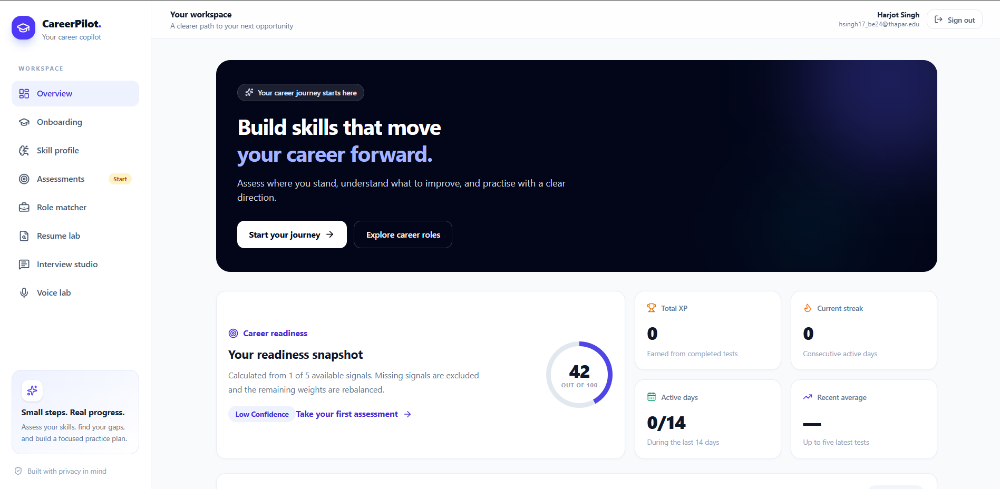
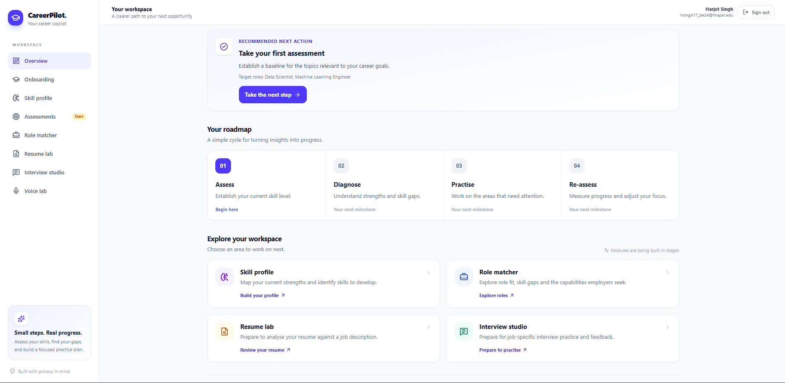
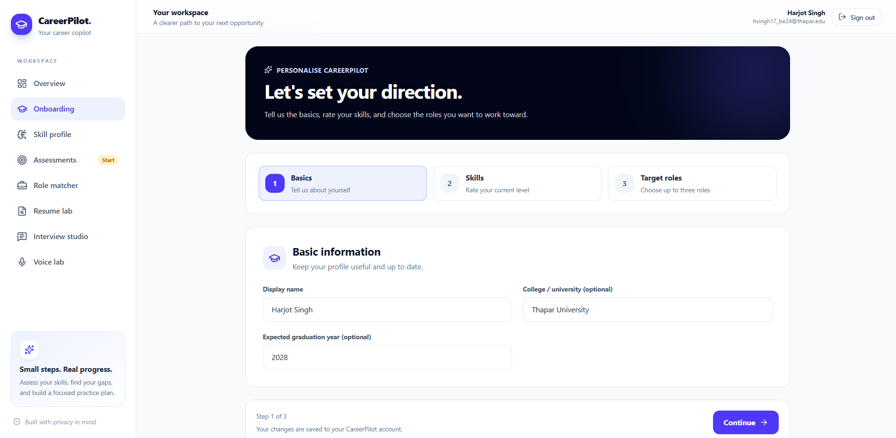
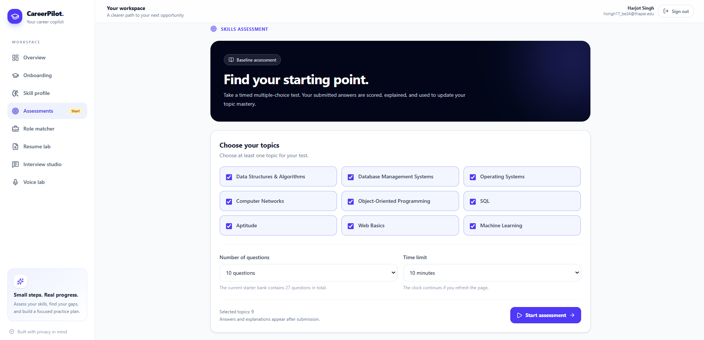
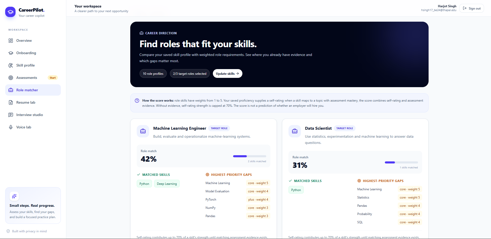
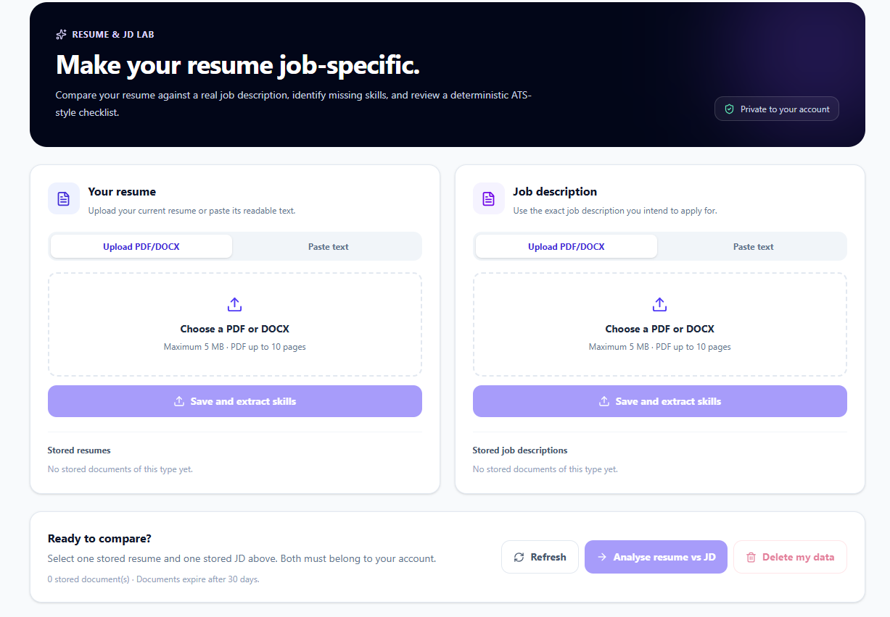
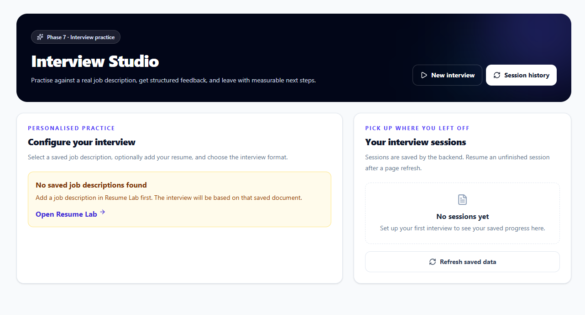
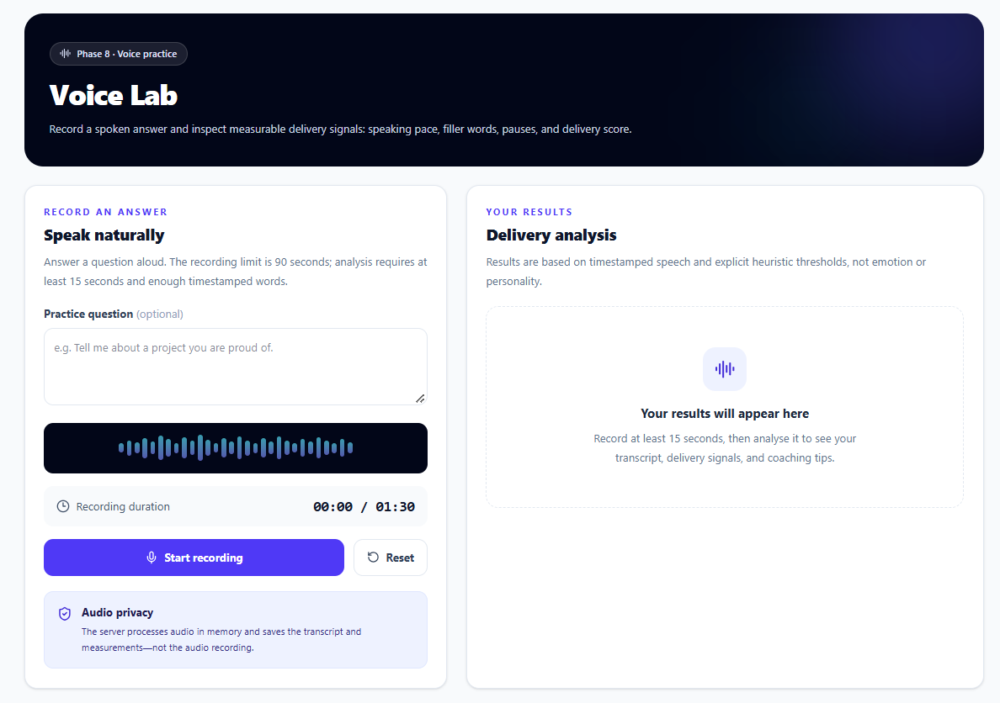
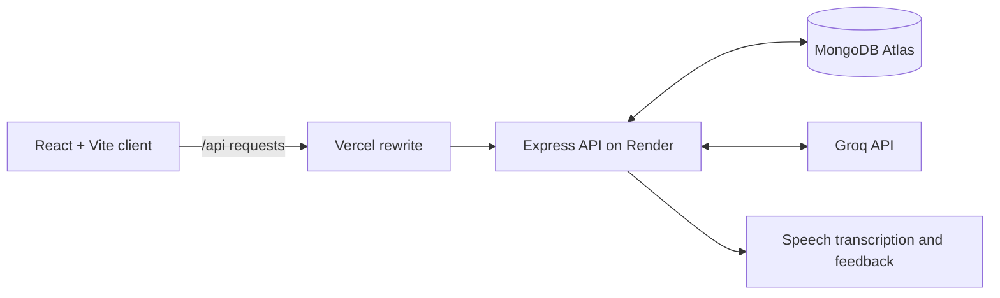

<div align="center">

# 🎓 CareerPilot

### Your career copilot — from skill awareness to interview practice.

A full-stack career-readiness workspace for students to understand their strengths, discover skill gaps, practise assessments, explore career roles, tailor a résumé to a job description, and prepare for interviews.

<p>
  <a href="https://careerpilot-roan.vercel.app/"></a>
  <a href="https://careerpilot-2-1nyp.onrender.com/api/health"></a>
  <a href="https://github.com/Harjotsingh0311/careerpilot"></a>
</p>

<p>
  
  
  
  
  
  
  
</p>

</div>

---

## ✨ At a glance

CareerPilot brings several parts of a student's career preparation journey into one place. It connects self-assessment and skill evidence with practical tools for exploring roles, reviewing application materials, and practising communication.

| Module | What's built |
|---|---|
| **Overview** | Career-readiness snapshot, progress indicators, experience points, activity streak, and a four-stage roadmap. |
| **Onboarding** | Guided setup for basic information, current skill levels, and target roles. |
| **Skill profile** | A place to record skills and proficiency and identify areas to develop. |
| **Assessments** | Topic-based multiple-choice practice with configurable question count and time limit; submitted answers support mastery tracking. |
| **Role matcher** | Weighted role-fit comparisons that show matched skills and highest-priority gaps. Scores are guidance, not hiring predictions. |
| **Resume & JD Lab** | Upload or paste résumé and job-description content, review skill overlap and an ATS-style checklist, and identify gaps. |
| **Interview Studio** | Job-description-focused interview practice with saved sessions and structured feedback. |
| **Voice Lab** | Record a spoken response and inspect transcript-based delivery signals such as pace, filler words, pauses, and a delivery score. |

## 🖼️ Product tour

These screenshots show the implemented product rather than conceptual mockups.

### 01 · Overview & progress

The dashboard brings readiness signals, XP, streaks, next actions, and the assess → diagnose → practise → re-assess roadmap together.

<p align="center">
  
</p>

<p align="center"><em>Overview — a quick snapshot of progress and the next step.</em></p>

<p align="center">
  
</p>

<p align="center"><em>Roadmap — a clear path from assessment to re-assessment.</em></p>

### 02 · Onboarding

A guided three-step setup for personal basics, skill ratings, and the roles the student wants to work towards.

<p align="center">
  
</p>

### 03 · Assessments

Choose subject areas, question count, and time limit before starting a baseline assessment.

<p align="center">
  
</p>

### 04 · Role matcher

Compare a saved skill profile with role requirements. Matched skills and priority gaps are visible side by side.

<p align="center">
  
</p>

### 05 · Resume & JD Lab

Work with a résumé and a target job description in one workspace, then review the comparison workflow and stored documents.

<p align="center">
  
</p>

### 06 · Interview Studio

Set up job-focused practice and return to saved interview sessions.

<p align="center">
  
</p>

### 07 · Voice Lab

Record a practice answer and review speech transcription and measurable delivery cues. The interface states that raw audio is processed in memory and that the saved results are the transcript and measurements, not the recording.

<p align="center">
  
</p>

---

## 🧭 How it fits together



- **Frontend:** React, Vite, React Router, Tailwind CSS, Axios, and Recharts.
- **Backend:** Node.js, Express, Mongoose, Zod validation, JWT-based authentication, password hashing, cookies, and API rate limiting.
- **Data:** MongoDB Atlas.
- **AI:** Groq-powered feedback and speech transcription workflows.
- **Testing:** Vitest and Supertest on the backend; Vite production build for the client.
- **Deployment:** Vercel (client) + Render (API) + MongoDB Atlas (database).

## 🚀 Run locally

### Prerequisites

- Node.js and npm
- A MongoDB Atlas database or compatible MongoDB instance
- A Groq API key for AI-powered features

### 1. Clone the repository

```bash
git clone https://github.com/Harjotsingh0311/careerpilot.git
cd careerpilot
```

### 2. Configure and start the backend

```bash
cd server
npm install
cp .env.example .env
```

Open `server/.env` and set your own values:

```dotenv
NODE_ENV=development
PORT=5000
CLIENT_ORIGIN=http://localhost:5173
MONGODB_URI=your_mongodb_connection_string
JWT_ACCESS_SECRET=your_random_secret_at_least_32_characters
GROQ_API_KEY=your_groq_api_key
GROQ_MODEL_MAIN=openai/gpt-oss-120b
GROQ_MODEL_FALLBACK=openai/gpt-oss-20b
AI_CALLS_PER_USER_PER_DAY=40
```

Never commit your real `.env` file, database URI, JWT secret, or API key. Keep secrets on the server only.

Start the backend in this terminal:

```bash
npm run dev
```

### 3. Start the frontend in a second terminal

From the repository root:

```bash
cd client
npm install
npm run dev
```

Open the local Vite URL shown in the terminal (typically `http://localhost:5173`). The local API defaults to `http://localhost:5000/api`; production uses the same-origin `/api` path routed by Vercel.

## 🧪 Checks

Run backend tests:

```bash
cd server
npm test
```

Build the frontend for production:

```bash
cd client
npm run build
```

After deployment, the API health endpoint should return JSON indicating that the API is online and the database is connected:

- Live app: <https://careerpilot-roan.vercel.app/>
- API health through Vercel: <https://careerpilot-roan.vercel.app/api/health>

## 🔐 Privacy & scoring notes

- Keep secrets in server-side environment variables; never put them in browser-exposed `VITE_` variables.
- The résumé and job-description workflow is an ATS-style checklist, not a promise of a particular employer's ATS score.
- Role-fit percentages are skill-comparison signals, not predictions that an employer will hire someone.
- Voice Lab's UI states that raw recordings are not saved; transcripts and measurements are retained for the analysis workflow.
- Review your data and delete it when it is no longer needed. Avoid uploading sensitive personal or confidential documents.

## 🗺️ Next steps

CareerPilot is a learning-oriented project and can continue to improve through cross-browser testing, accessibility checks, broader pilot feedback, more question-bank coverage, and end-to-end testing of the main user journeys.

---

<div align="center">

**Built to turn career preparation into a repeatable loop: assess · diagnose · practise · re-assess.**

[Open CareerPilot](https://careerpilot-roan.vercel.app/) · [View the source](https://github.com/Harjotsingh0311/careerpilot)

</div>
